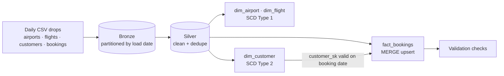
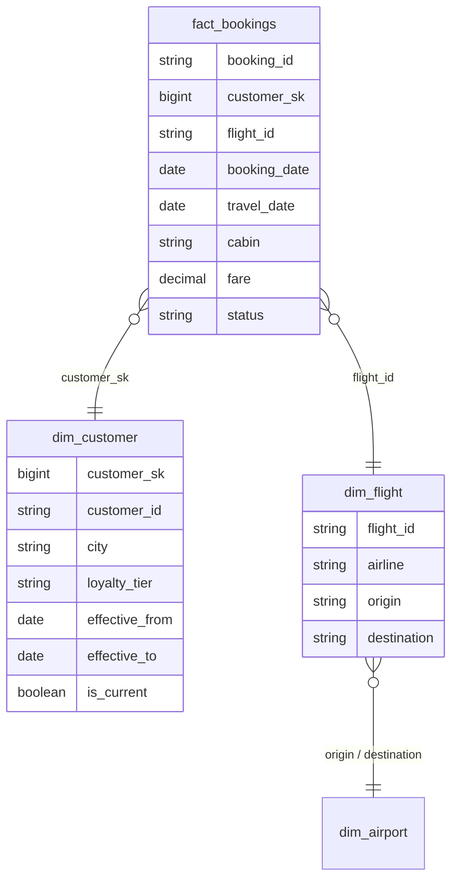

# Flight Bookings Data Warehouse

A star-schema data warehouse on Databricks that loads flight bookings **incrementally**, keeps full customer history with **SCD Type 2**, and upserts booking status changes with **Delta Lake `MERGE INTO`**.

**Stack:** Databricks · Spark SQL · PySpark · Delta Lake · Unity Catalog · Databricks Workflows

## What it shows

| Concept | Where |
| --- | --- |
| Incremental, idempotent loads (one daily drop at a time, safe to re-run) | `01_bronze_incremental` (`replaceWhere` on `_load_date`) |
| Cleaning and de-duplication | `02_silver_clean` |
| SCD Type 1 (overwrite) | `dim_airport`, `dim_flight` in `03_gold_dimensions` |
| **SCD Type 2** (history) | `dim_customer` in `03_gold_dimensions` |
| **MERGE INTO** upsert of changing facts | `fact_bookings` in `04_gold_fact` |
| Point-in-time joins (customer as they were when booking) | `customer_sk` lookup in `04_gold_fact` |
| Data validation that fails the job | `05_validate` |
| Orchestration | `workflows/flight_dw_job.json` |

## Architecture

## Star schema

## SCD Type 2 in one example

Say customer **CU0042** lives in Chennai on day 1 and moves to Pune on day 2:

| customer_sk | customer_id | city | effective_from | effective_to | is_current |
| --- | --- | --- | --- | --- | --- |
| 42 | CU0042 | Chennai | 2026-01-01 | 2026-01-01 | false |
| 517 | CU0042 | Pune | 2026-01-02 | 9999-12-31 | true |

Bookings made on day 1 keep pointing to row 42, so "revenue by city at time of booking" stays correct after the move.

## Sample data

Run `python scripts/generate_data.py` to create two daily drops in `data/raw/` (fixed seed, so the numbers below are repeatable):

* **Day 1 (2026-01-01):** 8 airports, 60 flights, 500 customers, 1,500 bookings.
* **Day 2 (2026-01-02):** 40 customers changed city or tier, 20 new customers, 1,500 new bookings, 60 status updates to day-1 bookings, and 10 duplicate rows.

## How to run (Databricks Free Edition)

1. **Workspace → Create → Git folder**, paste this repo's URL.
2. Run `00_setup`, then upload the four `data/raw/` sub-folders into the `workspace.flights.raw` volume.
3. Run notebooks `01` → `05` with `load_date = 2026-01-01`.
4. Run them again with `load_date = 2026-01-02` and check `05_validate` for the SCD2 history.
5. Optional: create the job from `workflows/flight_dw_job.json` to run the steps as one pipeline.
6. Try the queries in `sql/analytics_queries.sql`, including Delta time travel.

## What I learned

* Staging the source twice (with and without a merge key) lets a single `MERGE` both close the old row and insert the new one.
* `replaceWhere` makes a re-run of the same day safe, with no duplicate rows.
* Joining facts on the surrogate key valid at the booking date keeps historical reports accurate.
